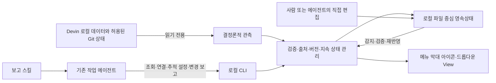

# 설계 변경안 — 협조형 보고와 파일 중심 Observer

2026-10-30. **설계 기록이며 구현 완료 보고가 아니다.** 사용자가 구현을 중단하고 플래닝을
진행하도록 지정한 상태에서, 대화로 추가한 요구사항과 남은 결정을 기록한다.

현재 구현 기준은 `f20696de11cbbe833a84c80bb9ad25c286021104`다. 기존 코드의 SQLite 저장,
웹 대시보드, 별도 모델을 통한 수동 Semantic Refresh는 그대로다. 이번 문서 커밋은 코드·설정·
실행 중인 프로그램·자동 실행 등록을 바꾸지 않는다.

## 0. 사용자 후속 확정 — 이번 결정이 우선

- 보고 신뢰성은 실용적인 수준이면 충분하다. 매 턴 의미 보고와 완전성을 강제하지 않는다.
- 같은 항목은 마지막 성공 커밋을 현재 상태로 사용한다. **의미적인 조정은 세션이 맡는다.**
- **읽기 → 판단 → 쓰기는 낙관적 락을 사용한다.** 읽은 revision이 유지됐을 때만 원자적으로 커밋한다. 바뀌면 최신 값·작성 세션을 반환하고 세션이 재판단한다.
- 판단하는 동안 락을 잡지 않는다. 최종 버전 확인·저장에만 짧은 내부 락을 사용한다. 일관성·중단 복구는 구현 담당자가 챙긴다.
- 현재 비용 예상은 수용하고 실제 사용에서 측정·조정한다. 사전 비용·충실도 증명을 새 착수 조건으로 요구하지 않는다.
- 각 세션이 자신이 기여하는 태스크의 지속추적 항목을 스스로 정의한다. 사람의 중앙 항목 설계를 전제로 삼지 않는다.
- 항목마다 마지막 업데이트 세션과 revision·이력을 남긴다. 자기 업데이트와 중간에 다른 세션이 쓴 내용을 구분할 수 있어야 한다.

구체적인 저장·출처·최신 상태 정책은 [상태 트랜잭션 계약](STATE_TRANSACTION_CONTRACT_2026-10-30_KO.md)에 기록한다.
초기 락 대기 제안은 후속 낙관적 락 결정으로 대체됐다. 위 내용은 구현을 시작하라는 지시가 아니다.

## 1. 이것은 무엇을 위한 변경인가

사용자가 여러 Devin 세션을 다시 열어 상태를 묻거나 수동으로 정리하지 않아도, 태스크별로
지속추적하는 내용을 읽을 수 있게 한다. 기본 사실은 Observer가 결정론적으로 수집하고,
의미 판단은 문맥을 이미 가진 작업 에이전트가 수행해 필요한 변경만 보고한다.

Observer 데몬·CLI·조회에는 추가 LLM 호출을 두지 않는다. 에이전트가 지침을 읽고 판단하고
보고하는 데에는 기존 작업 세션의 토큰이 든다. 별도 분석 비용 감소가 목표이며 전체 비용 절감을
입증한 것은 아니다. 사용자는 현재 예측을 수용했다. 사전 실험을 새 착수 조건으로 요구하지 않고
실제 사용하면서 캐시 효율, 보고 빈도, 도구 호출과 작업 방해를 측정·조정한다.

## 2. 기존 방향에서 바뀌는 것

| 항목 | 기존 구현·계획 | 새 제품 방향 |
|---|---|---|
| 기본 관측 | Devin 원본을 읽고 결정론적으로 변경 저장 | 유지. 보고 기능 없이도 기본 관측은 작동 |
| 의미 상태 | 별도 모델이 선택한 증분을 해석 | 작업 에이전트의 선택적 능동보고를 기본 후보로 전환 |
| 세션 협조 | 에이전트 보고 계약을 요구하지 않음 | 보고를 켠 세션에는 스킬·CLI를 통한 보고 계약 적용 |
| 태스크 관계 | 사용자 중심 태스크 등록·세션 연결 | 에이전트도 CLI로 참여 태스크 조회·후보 파악·명시적 연결 |
| 지속추적 | View와 분석 지침 중심 | 각 세션이 태스크별 항목을 스스로 정의하고 조회·추가·삭제 |
| 영속상태 | Observer SQLite가 중심 | 로컬 디렉터리와 JSON/YAML/Markdown을 가능한 범위에서 원본으로 사용 |
| 사용자 View | 로컬 웹 대시보드 | macOS 메뉴 막대 아이콘과 드롭다운 |
| 기술 스택 | Python 중심 코어와 웹 UI | 코어는 익숙한 스택 재사용, OS 연동의 Swift 최소화 |

이 문서는 새 방향을 기록한다. 기존 P0~M2 기록은 해당 시점의 구현·검증 증거로 보존한다.
아래 방향이 충돌하는 부분은 미래 설계에 우선 적용하지만, 기존 기능의 삭제나 데이터 변환을
지금 실행하도록 승인한 것은 아니다.

## 3. 전체 구조와 책임



Observer는 작업 세션에 ACP로 접속해 질문하거나 제어권을 획득하지 않는다. 보고를 활성화한
에이전트가 자기 작업 흐름 안에서 CLI를 호출해 Observer에 정보를 전달한다. 관측과 보고는
출처가 다른 입력이며 어느 쪽도 무조건 진실로 취급하지 않는다.

| 구성요소 | 책임 |
|---|---|
| 데몬 | 원본 관측, 파일 변경 감지, 검증, 재시도, 상태·출처·신선도 관리 |
| 에이전트용 CLI | 조회와 상태 변경의 공통 진입점. 파싱 가능한 결과와 검증 오류 제공 |
| 스킬 | CLI 사용법, 추적 항목 확인 방법, 보고 기준을 현재 작업 세션에 설명 |
| 결정론적 Core | 태스크 범위·ID·버전·중복·권한·근거를 검사하고 조건부 커밋. 의미 조정은 세션에 맡김 |
| 파일 저장소 | 사람이 읽고 에이전트가 직접 편집·검증할 수 있는 영속상태의 원본 |
| 메뉴 막대 UI | 저장된 상태 조회, 관측·보고·검증 문제를 투명하게 표시 |
| 훅 | 필요한 시점의 지침 상기·수집·검사를 보조하는 후보. 구체 방식은 미확정 |

## 4. 에이전트가 할 수 있어야 하는 일

1. 현재 세션의 식별과 참여 태스크를 조회한다. 세션 ID는 추측해 만들지 않는다.
2. 관련 태스크를 파악하거나 명시적으로 연결한다. 후보와 확정 연결의 경계는 정해야 한다.
3. 태스크 설명과 지속추적 항목, 현재 값, 근거, 최근 보고, 업데이트 세션·revision을 읽는다.
4. 각 세션이 스스로 지속추적 항목을 정의·추가·삭제한다. 삭제와 권한·이력 보존의 구체 계약은 구현 시 정리한다.
5. 스킬을 통해 자동보고를 시작하거나 중단한다.
6. 활성화 중인 추적 항목에 의미 있는 변화가 있다고 판단하면 변경과 근거만 보고한다.
7. 직접 편집한 파일이나 보고를 모델 호출 없이 자체 검증하고 구체적인 오류를 확인한다.

CLI의 명령 이름·출력 형식은 아직 확정하지 않았다. 현재 `observerctl`은 프로세스 설정·실행·
상태·로그인 실행 관리용이며 위 에이전트용 기능을 이미 제공하는 것으로 설명하면 안 된다.

## 5. 태스크·세션·지속추적 항목

- 태스크와 세션의 다대다 관계를 유지한다. 한 세션의 보고를 연결된 모든 태스크에 무조건 복제하지 않는다.
- 지속추적 항목은 각 세션이 태스크별로 스스로 정한다. 고정된 카테고리나 사용자의 사전 항목 설계를 강제하지 않는다.
- 예: 구현 태스크의 호환성·테스트·블로커, 조사 태스크의 가설·근거·미해결 질문, 설계 태스크의 결정·대안.
- 추적 항목에는 안정적인 식별자가 필요하다. 이름을 바꿔도 동일 항목인지 판별할 수 있어야 한다.
- 보고 대상은 세션·태스크·추적 항목에 연결한다. 항목마다 최신 성공 커밋과 업데이트 세션을 표시하고 이전 값·출처는 이력에 남긴다.
- 낙관적 revision 검사로 읽은 뒤 바뀐 항목·계약을 감지한다. 충돌 시 최신 값·작성 세션을 반환하고 의미적 조정은 세션에 맡긴다.
- 인간의 수정·핀·확인 위치·기존 근거와 자유로운 Persistent View를 보존한다.

## 6. 자동보고의 의미와 한계

예상 흐름은 참여 태스크·추적 목록 확인 → 보고 활성화 → 일반 작업 → 변화 판단 → 변경 보고 →
Core 검증·저장 → 메뉴 막대 View 갱신 → 필요 시 보고 중단이다.

여기서 자동은 **작업 중인 에이전트가 반복 수동 지시 없이 보고한다**는 뜻이다. 모델이 쉬거나
종료됐을 때 자동으로 깨워 새 판단을 시키는 스케줄러를 뜻하지 않는다. 별도 LLM 호출이나
기존 세션에 대한 숨은 프롬프트 전송을 추가하지 않는다.

보고가 없는 것과 변화가 없는 것은 다르다. 수집 성공, 보고 활성화, 마지막 보고, 추적 계약의
최신성, 보고 누락·오류를 구분해 표시해야 한다. 보고 활성화를 켰다는 이유만으로 최신·정확한
태스크 상태를 보장하지 않는다. 보고의 형식 유효성과 사실의 정확성도 별개다.
사용자는 실용적인 보고 수준을 수용했다. 매 턴 보고·완전 보고를 강제하거나 이를 위해 원래 작업을 막지 않는다.

보고는 전체 View 재작성보다 항목별 변경을 지향한다. 검토할 최소 정보는 report ID, session ID,
task ID, tracking item ID, 계약·대상 버전, 업데이트 세션, 변경 내용, 가능한 근거 참조다. 실제 스키마는 아직 없다.
완료·해결 보고는 `agent-reported`로 취급하고 독립 검증된 사실과 구분한다.

## 7. 스킬과 훅: 논의된 구성과 미확정 사항

확정된 방향은 스킬로 CLI와 보고법을 가르치고 보고를 시작·중단할 수 있게 하는 것이다.
스킬이 모델에 의해 선택·준수된다는 사실만으로 누락 없는 실행이 보장되지는 않는다.

논의된 구현 후보는 **훅을 한 번 설치하고 세션별 보고 활성화 상태로 동작을 분기하는 방식**이다.
스킬이 시작·중단 스크립트를 호출하고 훅은 등록된 세션만 처리한다. 그러나 이 방식은 아직
선정되거나 검증되지 않았고, 매번 훅을 설치·삭제하는 방식도 확정하지 않았다.

- 명령형 훅의 수집·검사는 별도 LLM 호출 없이 가능하지만, 훅 자체가 의미를 해석하지는 않는다.
- prompt형 훅은 추가 모델 비용이 생길 수 있어 초기 핵심 경로로 선정하지 않았다.
- 종료를 강제로 차단해 보고를 요구하는 방식은 원래 작업을 방해하거나 반복을 만들 수 있다.
- 세션별 범위, 비정상 종료 시 활성화 해제, 만료·재개, 훅 없는 동작 범위를 정해야 한다.
- Devin 스킬의 실행 동안만 훅을 자동 등록·해제하는 계약과 설정 수정의 즉시 반영은 확인하지 못했다.

공식 [스킬 형식](https://docs.devin.ai/cli/extensibility/skills/creating-skills)과
[훅 문서](https://docs.devin.ai/cli/extensibility/hooks/overview)를 검토했다.
기존 [P0 기록](P0_VALIDATION.md)의 Desktop `SessionStart`·`UserPromptSubmit`·`Stop` 검증은
기본 이벤트 관측이다. 새 능동보고 조합의 신뢰성·비용 검증으로 간주하지 않는다.

## 8. 파일 중심 영속상태

**가능한 많은 영속상태를 로컬 디렉터리와 JSON/YAML/Markdown으로 관리한다.** 사람이 읽고
에이전트가 직접 편집할 수 있어야 한다. 파일을 DB의 장식용 export로만 두는 방향은 요구와 맞지 않는다.
DB가 필요하다면 우선 재생성 가능한 인덱스·캐시 용도로 제한하고 예외는 따로 판단한다.
모든 상태에서 DB를 절대 금지하기로 한 것은 아니다.

아래는 구체화할 파일 배치의 예시다. 분할 방식·포맷·경로는 아직 확정하지 않았다.

```text
observer-state/
  schemas/<version>/
  tasks/<task-id>/task.yaml
  tasks/<task-id>/tracking.yaml
  tasks/<task-id>/view.md
  tasks/<task-id>/notes.md
  sessions/<session-id>/session.json
  contributions/<contribution-id>.json
  reports/<session-id>/<report-id>.json
```

구조화된 정의·상태는 JSON/YAML, 자유로운 메모·표현은 Markdown을 활용한다. 관계를 여러 파일에
중복 저장한다면 어느 쪽이 원본인지 명확해야 한다. 체크포인트·수신 처리 기록·이력의 저장 위치와
일관성은 [낙관적 트랜잭션 계약](STATE_TRANSACTION_CONTRACT_2026-10-30_KO.md)에 따라 구현 담당자가 챙긴다.
기존 SQLite의 원자성 보장을 파일로 옮겼다고 가정하지 않는다.

CLI를 통하지 않는 직접 편집도 정식 사용 방식으로 지원한다. 편집 중 부분 저장, 파일 이동·삭제,
동시 수정, 잘못된 참조, 지원하지 않는 버전에 견디면서 사용자 정보를 보존해야 한다.

## 9. 스키마와 내결함성

요구사항은 다음과 같다.

1. 버전 있는 스키마와 예제를 제공해 사람과 에이전트가 스스로 검증할 수 있게 한다.
2. 개별 파일·태스크·전체 저장소 검증을 CLI에서 모델 호출 없이 실행할 수 있게 한다.
3. 문법·필수값·타입과 ID 중복·교차 참조·권한·상태 전이의 검사를 구분한다.
4. 자유로운 태스크별 항목과 View를 허용하면서 공통 식별자와 관계의 무결성을 검사한다.
5. 깨진 상태를 숨기지 않고 파일·필드·원인·영향 범위를 CLI와 메뉴 막대 View에 표시한다.
6. 원문을 보존하고 임의 삭제·재작성으로 정상인 것처럼 만들지 않는다.
7. 한 파일·항목의 오류로 무관한 태스크와 정상적인 관측까지 멈추지 않도록 한다.

다음은 구체화를 위한 처리 원칙의 제안이며 검증된 구현이 아니다.

| 상태 | 목표 동작 |
|---|---|
| 일시적인 쓰기 중 상태 | 안정화 후 재검사. 무한 대기하거나 조용히 성공 처리하지 않음 |
| 필드·항목 일부 오류 | 안전하게 분리 가능한 정상 부분은 사용하고 오류 범위 표시 |
| 구문 오류·필수 식별자 손상 | 해당 내용을 현재 유효 상태로 반영하지 않고 원문·오류 노출 |
| 참조 대상 없음·중복 ID·동시 수정 | 불확실한 반영을 멈추고 문제를 특정. 다른 태스크는 가능한 범위에서 계속 |
| 지원하지 않는 스키마 버전 | 내용을 보존하고 지원 범위 표시. 이해하지 못한 파일 자동 재작성 금지 |
| 이전 정상 상태를 표시 | 이전 상태임을 명시하고 현재 상태와 혼동하지 않음 |
| 복구된 파일 | 재검증 뒤 반영. 같은 보고의 재처리로 중복 상태를 만들지 않음 |

내결함성은 잘못된 상태를 사실로 채택하는 뜻이 아니다. 위험한 상태 반영과 체크포인트 진행은
보수적으로 다루면서 조회·진단·정상 범위 작업을 유지한다. 마지막 정상 상태 보관, 충돌 처리,
원자적 저장과 다중 파일 커밋은 낙관적 revision 검사·짧은 커밋 구간·중단 복구 계약에 따라 구체화·검증한다.

## 10. macOS 메뉴 막대 View와 익숙한 스택

사용자가 브라우저 주소로 접속하도록 요구하지 않는다. 주 화면은 macOS 상단 메뉴 막대
아이콘과 그 드롭다운이다. 관측 상태와 태스크별 지속 상태를 그 안에서 확인한다.
긴 내용의 탐색·편집·설정 범위를 어떤 네이티브 UI로 제공할지는 아직 미결정이다.

표시할 후보 정보는 수집 정상·재시도·중단, 마지막 성공 수집, 관측 세션, 보고 활성화·마지막 보고,
태스크별 추적 항목과 현재 값·변경·근거, 미보고·오래됨·충돌·파일 검증 오류다.
데몬 실행과 데이터 신선도를 같은 정상 아이콘 하나로 합치지 않는다.

핵심 로직은 익숙한 스택을 최대한 쓴다. 기존 Python 코어를 재사용하고 필요한 부분에 JS·셸을
사용한다. 메뉴 막대 때문에 핵심 로직을 Swift로 옮기지 않는다. OS 연결도 Python·JS로 가능한
방식을 먼저 검토하고 Swift는 불가피한 얇은 연결 부분으로 최소화한다. Swift를 절대 금지한 것은 아니다.
무거운 Electron 등 데스크톱 런타임은 도입하지 않는다. 구체 GUI 라이브러리·IPC·패키징은 미선정이다.

## 11. 유지하는 불변식과 제외하는 경로

- 사용자는 기존 Devin Desktop·CLI·IDE에서 직접 일한다. 강제 wrapper·ACP 중재가 없다.
- Observer는 Devin 원본에 쓰거나 기존 세션을 점유·질의·제어하지 않는다.
- 보고는 참여 에이전트가 자기 실행 경로에서 Observer 쪽으로 전달한다.
- 기본 관측은 보고 기능이나 별도 모델이 없어도 계속 동작한다.
- 다대다 관계, 자유로운 Persistent View, 인간 수정·메모·핀·근거·확인 위치를 보존한다.
- 중복·출처·불확실성·보고/검증 구분을 유지한다. 같은 항목은 최신 성공 커밋을 표시하고 이전 값·출처를 이력에 보존한다. 의미적 조정은 세션에 맡긴다.
- 조회·검증·CLI·기본 수집에는 추가 LLM 호출이 없고 기본 telemetry도 없다.
- Observer 장애가 Devin 작업을 막지 않는다. 로컬 보고 전송 실패·재시도·보관 방식은 정해야 한다.
- 개인·회사 데이터와 인증 경계를 지킨다. 로컬 파일도 민감정보이며 원본·runtime 상태·인증은 Git에 넣지 않는다.
- **btw와 fork는 제품 후보에서 제외한다.** 검색은 부차 후보이며 핵심 상태 추적의 필수 경로로 삼지 않는다.
- 기존 `SemanticModelAdapter`와 독립 분석 기능의 보존·정리·예외 용도는 미결정이다. 지금 삭제하지 않는다.

## 12. 결정에 참고한 실제 실험과 해석 한계

실험은 별도 로컬 실험실, 개인 계정, 새 합성 세션에서 수행했다. 다음은 민감한 원본 대신
보고된 수치와 관측 결과만 정리한 것이다. 이번 문서 작업에서 모델 호출이나 재실험은 하지 않았다.

| 비교·관측 | 실제 결과 | 이번 설계에서의 해석 |
|---|---|---|
| btw | 테스트 환경에서 sidechain 지원 사전 조건으로 실패. 제3자 점유 세션 load도 거부 | 사용 경로에서 제외. 모든 환경에서 불가능하다는 증명은 아님 |
| fork | 실제 Desktop이 점유하고 실행 중인 합성 세션도 private API로 fork 성공 | 기술 가능성과 별개로 후보에서 제외. native 자식 생성은 엄밀한 읽기 전용도 아님 |
| 기존 세션 직접 질의 | input 44,104 / cache read 44,000 / output 468 | 해당 실행에서 높은 cache hit |
| 동일 anchor의 fork 질의 | input 44,104 / cache read 10,016 / output 459 | 논리 입력은 같았고 첫 fork의 cache hit는 작았음 |
| deja-vu 선택 검색 후 모델 분석 | 합성 사례 input 44,065 → 10,699, 약 75.7% 감소 | query 적합성과 누락 위험 때문에 보조 후보 |

직접 질의 대조는 CLI 3000.11.228, SWE-1.6 Slow, 1,000개 합성 record를 한 history block으로
준비한 뒤 동일 질문으로 한 쌍을 측정했다. 직접 질의가 먼저였다. 반복 fork의 cache hit가 늘어난
이전 실험도 있다. 실제 1,000개 대화 turn·여러 모델·장기간 비용·과금액을 비교한 결과는 아니다.
cache read는 input의 부분집합이며 합산하지 않는다. 기존 세션이 항상 최저 비용이라고 일반화하지 않는다.

선택 검색 사례에서는 generic recall+모델이 6개 항목 중 3개, targeted retrieval+모델이 5개를
답한 경우가 있었다. 작은 합성 사례의 누락 관측이지 전체 정확도 추정이 아니다.
사용자의 검색에 대한 ‘50% 폐기’ 판단을 실측 정확도 50%라는 뜻으로 기록하지 않는다.

능동보고 경로 자체의 총비용·보고 충실도·작업 방해는 아직 검증하지 않았다. 기존 문맥의 캐시
효율 관측은 후보를 좁히는 근거이며 새 제품 흐름의 성공 증거는 아니다.

## 13. 구현 전에 정할 것과 이후 검증 계획

| 구현 시 구체화할 항목 | 정리할 이유 |
|---|---|
| 보고 활성화 범위·세션 식별·만료·재개 | 공유 workspace와 여러 태스크에 잘못 보고하는 것을 방지 |
| 세션의 항목 정의·변경·삭제와 계약 버전 | 세션이 스스로 추적을 구성하고 보호 영역·이력을 보존 |
| 실용적 보고의 활성화·마지막 보고·오래됨 표시 | 완전성을 강제하지 않으면서 상태를 투명하게 제공 |
| 최신 커밋·업데이트 세션·revision·이력의 표현 | 세션이 다른 세션의 중간 변경을 읽고 의미적으로 조정 |
| 낙관적 버전 검사·조건부 커밋·중단 복구의 구현 | 읽기–판단 시간에는 락 없이 작업하고 최종 반영만 원자적으로 보장 |
| 스키마 확장·마이그레이션·지원 버전 | 자유로운 View와 안전한 검증, 알 수 없는 필드 보존의 양립 |
| 훅 필요성·지원 범위·실패 처리 | 보고 준수와 실행 비간섭의 균형 |
| 메뉴 UI·설정·편집·배포·실행 관리 | 최소 native 코드와 실제 macOS 사용성·복구 검증 |
| 기존 DB·View·독립 분석 기능의 전환 | 기존 인간 데이터·근거·검증 성과를 보존 |

다음은 **향후 구현이 별도로 승인됐을 때의 검증 순서 제안**이다. 지금 실행하지 않는다.

1. 작은 계약과 합성 예시를 먼저 정한다. 두 세션/한 태스크, 한 세션/두 태스크와 각 세션의 항목 자체 정의를 포함한다.
2. 최소 파일 저장·검증·CLI를 격리된 상태에서 확인한다. 직접 편집·구문 오류·참조 오류·동시 수정·crash·재처리를 다룬다.
3. 실제 합성 Devin 세션에서 스킬 기반 보고를 시험한다. 지시 없이 변화 보고, 누락, 추적 계약 변경, 중단·재개·compaction을 측정한다.
4. 얇은 메뉴 막대 연결을 검증한다. 데몬 중단·오류·이전 정상 상태를 숨기지 않고 브라우저 없이 읽을 수 있어야 한다.
5. 실제 사용하면서 총 토큰, 유용한 갱신, 누락·중복, 작업 지연과 재질문 감소를 관찰·조정한다. 사전 비용·완전 보고 증명을 새 착수 조건으로 요구하지 않는다.
6. 충분한 검증 뒤 기존 상태 전환을 설계·시험한다. 되돌릴 수 있는 백업과 인간 데이터 보존을 먼저 확인한다.

현재 성과는 **방향과 미결정의 문서화**다. 이 파일에 설명한 능동보고 CLI·스킬·훅 조합·
파일 원본 상태·메뉴 막대 UI가 이미 구현되거나 제품 완료 기준을 통과했다고 보고하지 않는다.

커밋·푸시 후 수행한 [설계 평가](DESIGN_CHANGE_REVIEW_2026-10-30_KO.md)는 당시의 장점·위험·기존 코드 재사용 범위를 정리한다. 이후 확정한 0절과 [상태 트랜잭션 계약](STATE_TRANSACTION_CONTRACT_2026-10-30_KO.md)이 충돌하는 평가 권고보다 우선한다.
