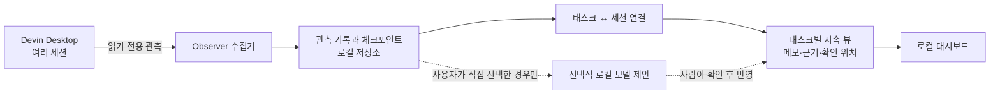

# Devin Task Observer: 목적부터 구현과 한계까지

## 1. 이것은 무엇인가

**Devin Task Observer는 여러 Devin 세션을 읽기 전용으로 관찰하고, 세션들이 함께 진행하는 ‘태스크’의 상태를 별도로 관리하기 위한 로컬 도구입니다.**

예를 들어 사용자가 로그인 기능을 만들면서 Devin 세션을 세 개 열었다고 해보겠습니다.

- 세션 A: 로그인 화면 구현
- 세션 B: 인증 API 조사
- 세션 C: 테스트 작성

Devin에서는 이들이 각각 별도의 대화입니다. 하지만 사용자 입장에서는 모두 **“로그인 기능 만들기”라는 하나의 태스크**에 속합니다.

Observer는 이 세션들을 하나의 태스크에 연결하고, 관련 기록과 사용자가 남긴 메모를 한곳에서 볼 수 있게 합니다. 세션을 종료하거나 새로 열어도 태스크 자체는 별도로 유지하는 것이 목표입니다.

### 이것은 무엇이 아닌가

- Devin을 대신 실행하거나 제어하는 프로그램이 아닙니다.
- 기존 Devin 세션에 프롬프트를 보내거나 명령을 내리지 않습니다.
- 새로운 실행 래퍼나 프록시를 통해서만 Devin을 사용하게 만드는 프로그램이 아닙니다.
- 현재로서는 세션을 완벽하게 이해해서 태스크 상태를 자동으로 정리하는 AI 비서가 아닙니다.
- 현재 이벤트 목록은 Devin의 전체 대화를 정확한 순서로 복원한 완전한 트랜스크립트가 아닙니다.

사용자는 평소처럼 Devin Desktop에서 작업하고, Observer는 별도로 실행되어 허용된 작업 공간의 세션을 읽습니다.

---

## 2. 무엇을 위한 것이며, 어떤 문제를 푸는가

AI 세션 중심으로 일하면 다음과 같은 문제가 생깁니다.

1. **하나의 작업이 여러 대화로 흩어집니다.**
   구현, 조사, 테스트가 각각 다른 세션에 있으면 전체 맥락을 보기 어렵습니다.

2. **세션과 태스크는 일대일 관계가 아닙니다.**
   하나의 태스크에 여러 세션이 참여할 수 있고, 하나의 세션이 여러 태스크에 기여할 수도 있습니다.

3. **대화는 길어지고 압축됩니다.**
   세션이 진행되면서 기록 구조가 바뀌거나 과거 내용이 현재 대화 경로 밖으로 이동할 수 있습니다.

4. **사용자가 정리한 정보와 AI의 기록이 섞이면 사람의 수정이 사라질 수 있습니다.**
   자동 요약이 기존 메모를 통째로 덮어쓴다면 사용자가 정리한 판단이나 중요한 주석을 잃을 수 있습니다.

5. **단순히 상태를 볼 때마다 LLM을 쓰면 비용과 불확실성이 생깁니다.**
   새 메시지가 생길 때마다 전체 대화를 모델로 분석할 필요는 없습니다.

Observer는 이를 위해 **세션에서 일어난 사실을 관측하는 부분**과 **태스크에 대해 사람이 유지하는 정보**를 분리합니다.

---

## 3. 어떤 방법으로 해결하는가

전체 구조는 다음과 같습니다.



핵심은 두 종류의 정보를 분리하는 것입니다.

- **관측 정보:** 어떤 세션의 어떤 기록이 추가·변경·누락되었는지
- **태스크 정보:** 어떤 세션이 어떤 태스크와 관련 있는지, 사람이 어떤 메모와 판단을 남겼는지

관측은 코드로 결정론적으로 처리합니다. 예를 들어 저장된 내용의 해시를 비교해서 바뀌었는지 판단합니다. 이 과정에는 LLM이 필요하지 않습니다.

의미를 해석하는 모델 기능은 별도로 두고 기본적으로 꺼져 있습니다.

---

## 4. 사용 흐름은 어떻게 되는가

현재 구현을 기준으로 하면 다음과 같습니다.

1. 사용자가 Devin Desktop에서 평소처럼 작업합니다.
2. Observer가 설정된 개인 작업 공간의 Devin 세션을 발견합니다.
3. 사용자가 대시보드에서 태스크를 만들고 관련 세션을 연결합니다.
4. Observer가 세션의 변경을 감지하고, 태스크에서 아직 확인하지 않은 변경을 표시합니다.
5. 사용자가 관련 기록의 원본을 확인하고, 필요한 내용을 태스크 뷰에 직접 메모하거나 근거로 연결합니다.
6. 나중에 다른 세션을 시작하면 같은 태스크에 추가로 연결할 수 있습니다.

예를 들어 로그인 작업에서 세션 A와 B를 같은 태스크에 연결한 뒤, B가 공통 인증 모듈도 조사했다면 B를 **“공통 인증 모듈 개선”** 태스크에도 연결할 수 있습니다.

다만 지금은 **세션이 어느 태스크에 속하는지 자동으로 판단하지 않습니다.** 연결과 메모 정리는 사용자가 직접 해야 합니다. 사용자의 개입을 줄이는 목표에 비해 아직 부족한 부분입니다.

---

## 5. 구체적인 기능과 구현 방식

### 5-1. Devin 세션 발견과 읽기 전용 관측

**하는 일**

허용된 작업 공간에서 Devin 세션을 찾고, 세션에 어떤 기록이 있는지 읽습니다.

**구현 방식**

실제 개인 Mac의 Devin Desktop에서 관측한 로컬 SQLite 데이터베이스를 읽기 전용으로 엽니다. 작업 공간 경로를 명시적으로 지정해야 하며, 확인된 데이터 구조와 다른 형식은 임의로 해석하지 않습니다.

구현: [devin_local.py](../observer/devin_local.py)

**확인한 것**

- 실제 합성 세션 3개를 동시에 구분했습니다.
- 세션 재시작 후에도 관측을 이어갔습니다.
- 실제 세션 진행 중 변경을 감지했습니다.
- Desktop에서 Hook 입력 형식도 일부 확인했지만, 현재 수집기는 Hook 설치를 요구하지 않습니다.

**부작용과 대응**

SQLite를 읽기 전용으로 열더라도 내부적으로 잠금이나 공유 메모리 조정에 참여할 수 있습니다. 짧은 읽기 트랜잭션과 제한된 대기 시간으로 영향을 줄였지만, **Devin에 영향이 절대 없다고 증명한 것은 아닙니다.** 장시간 부하 검증이 남아 있습니다.

---

### 5-2. 변경 감지와 체크포인트

**하는 일**

이전에 본 세션과 현재 세션을 비교해 기록의 추가·수정·누락·복원을 감지합니다.

**구현 방식**

각 노드의 식별자와 내용 해시를 비교합니다. 변경 기록과 체크포인트는 Observer의 별도 데이터베이스에 함께 저장합니다.

예를 들면:

```text
첫 관측: 노드 A, B
다음 관측: 노드 A, B, C

결과: C 추가
```

같은 상태를 다시 읽으면 C를 또 새로운 변경으로 기록하지 않습니다.

**부작용과 대응**

- 수집 중 오류가 나면 변경 기록과 체크포인트가 서로 어긋날 수 있습니다. 이를 줄이기 위해 둘을 하나의 데이터베이스 트랜잭션으로 저장합니다.
- 원본이 불완전하거나 구조가 예상과 다르면 잘못된 상태를 확정할 수 있습니다. 이 경우 체크포인트를 함부로 진행하지 않고 세션에 확인 필요 상태를 표시합니다.
- 같은 메시지가 여러 노드로 반복될 수 있습니다. 실제로 동일한 내용과 확인된 일부 타이밍 차이만 검토 목록에서 중복 표시를 줄이고, 원본 관측 기록은 보존합니다.

**남은 한계**

현재 방식은 변경 결과를 증분으로 기록하지만, 매번 선택된 세션의 노드를 다시 읽고 해시를 계산합니다. 즉, **데이터베이스에서 새 행만 효율적으로 읽는 완전한 증분 쿼리는 아닙니다.** 큰 세션에서의 성능도 더 검증해야 합니다.

---

### 5-3. 태스크와 세션의 다대다 관계

**하는 일**

태스크와 세션을 자유롭게 연결합니다.

```text
태스크 A ── 세션 1
         └─ 세션 2

태스크 B ── 세션 2
         └─ 세션 3
```

**구현 방식**

Observer의 로컬 저장소에 태스크와 세션 사이의 연결 기록을 둡니다. 연결을 해제해도 이력을 보존하며 다시 연결할 수 있습니다.

또한 **확인 위치는 태스크별로 따로 관리**합니다. 태스크 A에서 세션 2의 변경을 확인했다고 해서, 태스크 B에서도 그 변경을 확인한 것으로 처리하지 않습니다.

**부작용과 대응**

한 세션이 여러 태스크에 연결되면, 같은 변경이 여러 태스크에 나타날 수 있습니다. 이는 해당 변경이 각 태스크에서 각각 검토될 수 있기 때문에 의도된 동작입니다. 확인 이력은 분리해 서로 영향을 주지 않도록 했습니다.

---

### 5-4. 태스크별 Persistent View

**하는 일**

태스크에 대한 정보를 세션과 별도로 지속 보관합니다.

현재 뷰에서 할 수 있는 일은 다음과 같습니다.

- 섹션 만들기, 이름 바꾸기, 순서 변경
- 메모 추가와 수정
- 메모 고정
- 항목 상태를 명시적으로 변경
- 항목에 관측된 세션 근거 연결
- 항목을 다른 섹션으로 이동

**구현 방식**

각 섹션과 항목에 별도 식별자를 부여하고 Observer의 로컬 데이터베이스에 저장합니다. 변경할 때 뷰의 버전을 확인하므로 오래된 화면이 최신 수정을 조용히 덮어쓰지 않도록 합니다.

구현: [views.py](../observer/views.py)

**부작용과 대응**

여러 화면에서 같은 태스크를 편집하면 충돌할 수 있습니다. 버전이 다르면 자동으로 덮어쓰지 않고 충돌로 처리합니다.

AI가 기존 뷰를 재작성하거나 사람의 메모를 삭제하는 기능은 현재 없습니다. 사용자가 직접 저장한 정보가 중심입니다.

---

### 5-5. 근거 확인

**하는 일**

태스크의 메모가 어떤 세션 기록에 근거하는지 연결하고, 필요할 때 원본을 확인합니다.

**구현 방식**

Observer는 기본적으로 대화 본문을 복사해 저장하지 않고, 세션·노드·내용 해시를 참조합니다. 원본을 보여 줄 때 현재 데이터의 해시가 저장된 해시와 같은지 확인합니다.

실제 합성 세션에서 다음을 확인했습니다.

- 사용자 입력과 에이전트 응답
- 도구 호출과 결과
- 관측된 특정 형식의 계획 항목
- 해당 도구 호출에 추가된 메타데이터

계획의 `pending` 같은 값은 **에이전트가 기록한 상태**로 표시합니다. Observer가 실제 완료 여부를 검증한 것으로 표현하지 않습니다.

**부작용과 대응**

원본을 복사하지 않기 때문에, Devin이 나중에 원본 내용을 바꾸거나 지우면 **이전 본문은 더 이상 볼 수 없습니다.** Observer에는 그 내용이 있었다는 해시와 참조가 남지만 본문 복구는 할 수 없습니다.

이는 민감한 대화의 중복 저장을 줄이는 대신 과거 원문 보존성이 낮아지는 현재 설계의 명확한 한계입니다.

---

### 5-6. 로컬 대시보드

**하는 일**

위 기능을 확인하고 조작할 수 있는 간단한 화면입니다.

현재 화면은 대략 다음 구조입니다.

```text
┌───────────────────┬────────────────────────────────────┐
│ 태스크 목록       │ 선택한 태스크                      │
│                   │                                    │
│ 관측 세션 목록    │ 연결된 세션                        │
│                   │ 확인할 변경                        │
│                   │ 메모와 근거                        │
└───────────────────┴────────────────────────────────────┘
```

**구현 방식**

Mac의 로컬 주소에서만 접근하는 간단한 웹 서버입니다. 기본 대시보드 조회와 변경 감지에는 LLM 호출이 없습니다.

현재 화면은 기능 확인을 위한 초기 버전입니다. UI 디자인이나 사용성은 완성된 상태가 아니며, 말씀하신 대로 지금은 다듬기보다 핵심 기능 검증에 초점을 맞췄습니다.

**부작용과 대응**

로컬 웹 화면도 다른 웹사이트가 함부로 조작하지 못하도록 로컬 바인딩, 요청 토큰, 출처 확인 등의 방어를 넣었습니다. 다만 이는 **독립적인 보안 감사를 통과했다는 뜻은 아닙니다.**

---

### 5-7. 선택적 로컬 모델 제안

**하는 일**

사용자가 명시적으로 선택한 세션 기록 하나를 로컬 모델에 보내 참고용 메모를 제안받는 실험 기능입니다.

**구현 방식**

- 기본적으로 꺼져 있습니다.
- 전체 세션을 자동으로 분석하지 않습니다.
- 사용자가 선택한 짧은 기록 하나만 처리합니다.
- 제안은 기존 메모를 수정하지 않습니다.
- 사람이 확인하고 직접 수락해야 새 항목으로 추가됩니다.
- 같은 입력은 결과를 재사용해 불필요한 재분석을 줄입니다.
- 로컬 예산 제한을 둡니다.

**부작용과 대응**

모델은 틀린 해석이나 부정확한 제안을 만들 수 있습니다. 따라서 결과를 검증된 사실로 취급하지 않고, 사람의 수락을 요구합니다.

다만 이 기능은 아직 **여러 세션을 종합해 태스크 상태를 조정하는 의미 분석 기능이 아닙니다.** 현재는 작은 단위의 실험입니다. 모델이 생성한 제안에는 원본의 민감한 내용이 반복될 수 있고, 수락 여부와 관계없이 로컬 Observer 저장소에 남을 수 있습니다.

---

## 6. 현재 어디까지 실제로 됐는가

| 영역 | 현재 상태 |
|---|---|
| 실제 Devin Desktop 설치와 실행 | 개인 Mac에서 확인 |
| 여러 실제 합성 세션 발견 | 3개 세션으로 확인 |
| 읽기 전용 변경 감지 | 제한된 실제 합성 세션에서 확인 |
| 재시작과 압축 | 실제 합성 세션에서 일부 확인 |
| 태스크–세션 다대다 연결 | 구현 및 확인 |
| 태스크 메모와 근거 유지 | 구현 및 브라우저 확인 |
| 대시보드 | 기본 기능 프로토타입 |
| 로컬 모델 제안 | 기본 비활성화된 단일 기록 실험 |
| 전체 대화의 정확한 재구성 | **미완성** |
| 자동 태스크 연결·자동 상태 정리 | **미구현** |
| 장시간 안정성·다른 Devin 버전 | **미검증** |

마지막 실행에서 합성 테스트 **90개가 통과**했습니다. 실제 Devin 합성 세션에서 확인한 내용과 별도의 테스트용 가짜 데이터로 확인한 내용은 구분해 [검증 문서](P0_VALIDATION.md)와 [구현 진행 문서](P1_PROGRESS.md)에 기록했습니다.

## 7. 다음으로 가장 중요한 일

가장 중요한 다음 단계는 화면을 꾸미는 것이 아니라, **세션 기록을 신뢰할 수 있게 해석하는 것**입니다.

실제 관측에서는 같은 메시지가 여러 노드로 나타나고, 컨텍스트 압축 후 현재 대화 경로가 바뀌며, 저장된 시각만으로는 정확한 순서를 확정할 수 없었습니다. 이 문제를 더 검증하고 해결해야 여러 세션의 변화를 안전하게 태스크 상태에 반영할 수 있습니다.

현재 결과물은 [GitHub 초안 PR #1](https://github.com/neocjmix/devin-task-observer/pull/1)에서 확인할 수 있습니다.
