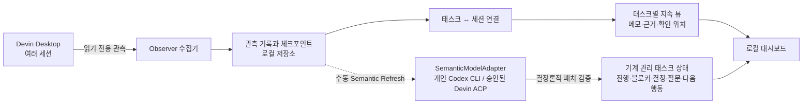

# Devin Task Observer: 목적부터 구현과 한계까지

## M2 모델 실행 방식 확정 (2026-10-29)

의미 분석은 작업 중인 Devin 세션에 질문하지 않고 **별도의 분석 실행**으로 수행한다. 개발·테스트 환경에서는 **Codex CLI 비대화형 실행**, 사내 실사용 환경에서는 **Devin ACP의 독립 분석 전용 세션**을 사용한다. 두 실행 경로는 동일한 `SemanticModelAdapter` 계약과 JSON 패치 검증기를 공유한다.

기존 사용자 작업 세션은 계속 읽기 전용이다. 매니저는 작업 세션을 점유하거나 프롬프트를 전송하지 않는다. ACP 분석 세션은 격리된 별도 세션이며, 도구 권한은 최소화한다. 분석 결과는 결정론적 검증을 거쳐 태스크의 기계 관리 상태에만 반영된다.

Codex CLI 경로는 개인 환경의 실제 실행과 두 합성 Desktop 세션의 브라우저 흐름까지 검증했다. CLI는 기존 외부 실행 파일의 경로를 참조하며 Observer에 번들하거나 자동 다운로드하지 않는다. Devin ACP의 무인 실행, 인증, 동시성, 권한 제한, 사용량 정보는 사내 대상 환경에서 별도 검증해야 하며 검증 전에는 실사용 지원을 확정하지 않는다. 기존 Ollama 단일 메시지 실험은 M2 기본 실행 수단이 아니다. 사내 세션 내용은 개인 Codex나 외부 모델로 보내지 않는다.

---

## 최종 제품 목표와 현재 구현의 차이 — 반드시 읽을 것

**최종 목표는 사용자가 태스크를 한 번 등록하고 관련 Devin 세션을 연결하면, 이후에는 세션마다 질문하거나 내용을 직접 옮겨 적지 않고도 태스크의 현재 상태를 읽을 수 있게 하는 것이다.** 구현·조사·설계 등 태스크마다 서로 다른 지속적 표현 구조를 유지하며, 진행 상황·블로커·결정·미해결 질문·다음 행동과 근거를 자동 갱신한다. 여러 세션의 기여를 태스크 단위로 종합한다.

M1의 읽기 전용 수집·리소스 후보·구조화 계획·Persistent View·Live 갱신 위에 **M2의 수동 증분 의미 분석과 지속 상태 자동 반영을 구현했다.** 두 세션의 진행·블로커·질문·다음 행동과 후속 변경을 실제 Codex CLI 및 합성 Desktop 세션으로 검증했다. 인간 메모는 별도로 유지한다. 실제 업무에서의 해석 품질과 사내 ACP 운영 검증은 남아 있다.

구현한 **M2 Semantic Task Tracking**은 기존 태스크 View와 마지막 의미 분석 이후 새로 관측된 증분을 비교해 LLM이 근거 있는 국소적 변경을 제안하도록 한다. 결정론적 Core가 출처·버전·중복·권한을 검증한 후 안전한 기계 관리 항목은 자동 반영한다. 사람의 메모, 고정 항목, 기존 결정을 조용히 덮어쓰지 않으며 충돌·불확실성은 드러낸다. 사용자의 승인은 위험한 변경에만 요구한다.

LLM은 전체 대화나 View를 매번 재요약하지 않는다. 일반 조회와 구조화된 사실 추출에는 0토큰을 사용하며, 의미 분석은 처음에는 수동 새로고침으로 실행하고 예산 상한을 적용한다. 예산 소진 시 기본 관측은 계속되고 의미 상태가 오래됐음을 표시한다. 세션에 별도 보고를 강제하거나 ACP 세션을 점유하지 않는다.

**M2의 성공 기준:** 두 세션의 새로운 대화에서 블로커와 다음 행동이 바뀌면, 한 번의 의미 새로고침 이후 안정적인 태스크 View에 근거와 함께 반영되고, 기존 인간 작성 정보가 보존되며, 재실행 시 중복되지 않아야 한다. M1의 규칙 기반 후보 추출만으로는 이 기준을 만족하지 못한다.

자세한 설계 및 수용 기준: [구현 계획](IMPLEMENTATION_PLAN.md), [상태 병합 계약](DATA_AND_RECONCILIATION.md), [검증 기준](VALIDATION_AND_HANDOFF.md).

---

## 1. 이것은 무엇인가

**Devin Task Observer는 여러 Devin 세션을 읽기 전용으로 관찰하고, 세션들이 함께 진행하는 ‘태스크’의 상태를 별도로 관리하기 위한 로컬 도구입니다.**

예를 들어 사용자가 로그인 기능을 만들면서 Devin 세션을 세 개 열었다고 해보겠습니다.

- 세션 A: 로그인 화면 구현
- 세션 B: 인증 API 조사
- 세션 C: 테스트 작성

Devin에서는 이들이 각각 별도의 대화입니다. 하지만 사용자 입장에서는 모두 **“로그인 기능 만들기”라는 하나의 태스크**에 속합니다.

Observer는 이 세션들을 하나의 태스크에 연결하고, 발견한 리소스 후보·세션별 계획·관련 기록과 사용자가 남긴 메모를 한곳에서 볼 수 있게 합니다. M1에서는 태스크를 만들고 관련 세션을 한 번 연결하면 이 관측 요약이 자동으로 갱신됩니다. 세션을 종료하거나 새로 열어도 태스크 자체는 별도로 유지하는 것이 목표입니다.

### 이것은 무엇이 아닌가

- Devin을 대신 실행하거나 제어하는 프로그램이 아닙니다.
- 기존 Devin 세션에 프롬프트를 보내거나 명령을 내리지 않습니다.
- 새로운 실행 래퍼나 프록시를 통해서만 Devin을 사용하게 만드는 프로그램이 아닙니다.
- 현재로서는 세션을 완벽하게 이해해서 태스크 상태를 자동으로 정리하는 AI 비서가 아닙니다.
- 현재 이벤트 목록은 Devin의 전체 대화를 정확한 순서로 복원한 완전한 트랜스크립트가 아닙니다.

사용자는 평소처럼 Devin Desktop에서 작업하고, Observer는 별도로 실행되어 허용된 작업 공간의 세션을 읽습니다.

---

## 2. 무엇을 위한 것이며, 어떤 문제를 푸는가

AI 세션 중심으로 일하면 다음과 같은 문제가 생깁니다.

1. **하나의 작업이 여러 대화로 흩어집니다.**
   구현, 조사, 테스트가 각각 다른 세션에 있으면 전체 맥락을 보기 어렵습니다.

2. **세션과 태스크는 일대일 관계가 아닙니다.**
   하나의 태스크에 여러 세션이 참여할 수 있고, 하나의 세션이 여러 태스크에 기여할 수도 있습니다.

3. **대화는 길어지고 압축됩니다.**
   세션이 진행되면서 기록 구조가 바뀌거나 과거 내용이 현재 대화 경로 밖으로 이동할 수 있습니다.

4. **사용자가 정리한 정보와 AI의 기록이 섞이면 사람의 수정이 사라질 수 있습니다.**
   자동 요약이 기존 메모를 통째로 덮어쓴다면 사용자가 정리한 판단이나 중요한 주석을 잃을 수 있습니다.

5. **단순히 상태를 볼 때마다 LLM을 쓰면 비용과 불확실성이 생깁니다.**
   새 메시지가 생길 때마다 전체 대화를 모델로 분석할 필요는 없습니다.

Observer는 이를 위해 **세션에서 일어난 사실을 관측하는 부분**과 **태스크에 대해 사람이 유지하는 정보**를 분리합니다.

---

## 3. 어떤 방법으로 해결하는가

전체 구조는 다음과 같습니다.



핵심은 두 종류의 정보를 분리하는 것입니다.

- **관측 정보:** 어떤 세션의 어떤 기록이 추가·변경·누락되었는지
- **태스크 정보:** 어떤 세션이 어떤 태스크와 관련 있는지, 사람이 어떤 메모와 판단을 남겼는지

관측은 코드로 결정론적으로 처리합니다. 예를 들어 저장된 내용의 해시를 비교해서 바뀌었는지 판단합니다. 이 과정에는 LLM이 필요하지 않습니다.

의미를 해석하는 모델 기능은 별도로 두고 기본적으로 꺼져 있습니다.

---

## 4. 사용 흐름은 어떻게 되는가

현재 구현을 기준으로 하면 다음과 같습니다.

1. 사용자가 Devin Desktop에서 평소처럼 작업합니다.
2. Observer가 설정된 개인 작업 공간의 Devin 세션을 발견합니다.
3. 사용자가 대시보드에서 태스크를 만들고 관련 세션을 연결합니다.
4. Observer가 리소스 후보와 세션별 계획을 자동으로 표시하고, 열린 태스크의 변경 목록도 갱신합니다. 작성 중인 입력은 유지합니다.
5. 의미 분석을 명시적으로 설정했다면 Semantic Refresh로 새 자연어 변경을 분석합니다. 안전한 상태 갱신은 자동 반영되며, 사용자 메모는 보존됩니다. 저장된 상태 조회에는 모델 호출이 없습니다.
6. 나중에 다른 세션을 시작하면 같은 태스크에 추가로 연결할 수 있습니다.

예를 들어 로그인 작업에서 세션 A와 B를 같은 태스크에 연결한 뒤, B가 공통 인증 모듈도 조사했다면 B를 **“공통 인증 모듈 개선”** 태스크에도 연결할 수 있습니다.

다만 지금은 **세션이 어느 태스크에 속하는지 자동으로 판단하지 않습니다.** 최초 연결과 선택적인 메모 작성은 사용자가 합니다. 연결 이후의 리소스 후보와 관측된 계획은 LLM 없이 자동 정리되며, 후보를 수동으로 확인하지 않아도 목록을 볼 수 있습니다. M2 모델 해석은 reported/hypothesis로 구분하며, 실제 완료나 외부 상태를 검증한 것으로 확정하지 않습니다.

---

## 5. 구체적인 기능과 구현 방식

### 5-1. Devin 세션 발견과 읽기 전용 관측

**하는 일**

허용된 작업 공간에서 Devin 세션을 찾고, 세션에 어떤 기록이 있는지 읽습니다.

**구현 방식**

지원이 검증된 범위는 **Devin Desktop 3.10.67의 Devin Local / SQLite 스키마 17**입니다. 해당 환경에서 관측한 로컬 SQLite 데이터베이스를 읽기 전용으로 엽니다. Cloud, Cascade, 다른 버전은 지원이 검증되지 않았습니다. 작업 공간 경로를 명시적으로 지정해야 하며, 확인된 데이터 구조와 다른 형식은 임의로 해석하지 않습니다.

구현: [devin_local.py](../observer/devin_local.py)

**확인한 것**

- 실제 합성 세션 3개를 동시에 구분했습니다.
- 세션 재시작 후에도 관측을 이어갔습니다.
- 실제 세션 진행 중 변경을 감지했습니다.
- Desktop에서 Hook 입력 형식도 일부 확인했지만, 현재 수집기는 Hook 설치를 요구하지 않습니다.

**부작용과 대응**

SQLite를 읽기 전용으로 열더라도 내부적으로 잠금이나 공유 메모리 조정에 참여할 수 있습니다. 짧은 읽기 트랜잭션과 제한된 대기 시간으로 영향을 줄였지만, **Devin에 영향이 절대 없다고 증명한 것은 아닙니다.** 장시간 부하 검증이 남아 있습니다.

---

### 5-2. 변경 감지와 체크포인트

**하는 일**

이전에 본 세션과 현재 세션을 비교해 기록의 추가·수정·누락·복원을 감지합니다.

**구현 방식**

각 노드의 식별자와 내용 해시를 비교합니다. 변경 기록과 체크포인트는 Observer의 별도 데이터베이스에 함께 저장합니다.

예를 들면:

```text
첫 관측: 노드 A, B
다음 관측: 노드 A, B, C

결과: C 추가
```

같은 상태를 다시 읽으면 C를 또 새로운 변경으로 기록하지 않습니다.

**부작용과 대응**

- 수집 중 오류가 나면 변경 기록과 체크포인트가 서로 어긋날 수 있습니다. 이를 줄이기 위해 둘을 하나의 데이터베이스 트랜잭션으로 저장합니다.
- JSON 손상·미지원 스키마 등으로 읽기를 신뢰할 수 없으면 체크포인트를 보존하고 자동 재시도합니다. 읽을 수 있지만 해석이 모호하거나 구조가 달라졌다면 관측과 체크포인트는 저장하고 각각 모호함·구조 변경 경고를 표시합니다. 정상적으로 관측된 압축이나 동일 중복 노드는 수동 복구를 요구하지 않습니다.
- 같은 메시지가 여러 노드로 반복될 수 있습니다. 실제로 동일한 내용과 확인된 일부 타이밍 차이만 검토 목록에서 중복 표시를 줄이고, 원본 관측 기록은 보존합니다.

**남은 한계**

현재 방식은 변경 결과를 증분으로 기록하지만, 매번 선택된 세션의 노드를 다시 읽고 해시를 계산합니다. 즉, **데이터베이스에서 새 행만 효율적으로 읽는 완전한 증분 쿼리는 아닙니다.** 큰 세션에서의 성능도 더 검증해야 합니다.

---

### 5-3. 태스크와 세션의 다대다 관계

**하는 일**

태스크와 세션을 자유롭게 연결합니다.

```text
태스크 A ── 세션 1
         └─ 세션 2

태스크 B ── 세션 2
         └─ 세션 3
```

**구현 방식**

Observer의 로컬 저장소에 태스크와 세션 사이의 연결 기록을 둡니다. 연결을 해제해도 이력을 보존하며 다시 연결할 수 있습니다.

또한 **확인 위치는 태스크별로 따로 관리**합니다. 태스크 A에서 세션 2의 변경을 확인했다고 해서, 태스크 B에서도 그 변경을 확인한 것으로 처리하지 않습니다.

**부작용과 대응**

한 세션이 여러 태스크에 연결되면, 같은 변경이 여러 태스크에 나타날 수 있습니다. 이는 해당 변경이 각 태스크에서 각각 검토될 수 있기 때문에 의도된 동작입니다. 확인 이력은 분리해 서로 영향을 주지 않도록 했습니다.

---

### 5-4. 태스크별 Persistent View

**하는 일**

태스크에 대한 정보를 세션과 별도로 지속 보관합니다.

현재 뷰에서 할 수 있는 일은 다음과 같습니다.

- 섹션 만들기, 이름 바꾸기, 순서 변경
- 메모 추가와 수정
- 메모 고정
- 항목 상태를 명시적으로 변경
- 항목에 관측된 세션 근거 연결
- 항목을 다른 섹션으로 이동

**구현 방식**

각 섹션과 항목에 별도 식별자를 부여하고 Observer의 로컬 데이터베이스에 저장합니다. 변경할 때 뷰의 버전을 확인하므로 오래된 화면이 최신 수정을 조용히 덮어쓰지 않도록 합니다.

구현: [views.py](../observer/views.py)

**부작용과 대응**

여러 화면에서 같은 태스크를 편집하면 충돌할 수 있습니다. 버전이 다르면 자동으로 덮어쓰지 않고 충돌로 처리합니다.

M2의 자동 상태는 별도 기계 관리 영역에 저장합니다. AI는 인간 View의 본문·핀·순서를 재작성하지 않습니다. 사용자가 자동 항목을 수정하거나 고정하면 해당 항목도 인간 소유가 되어 이후 자동 덮어쓰기를 막습니다.

---

### 5-5. 근거 확인

**하는 일**

태스크의 메모가 어떤 세션 기록에 근거하는지 연결하고, 필요할 때 원본을 확인합니다.

**구현 방식**

Observer는 전체 대화 본문을 보관하지 않고, 세션·노드·내용 해시를 참조합니다. M1의 자동 추출 리소스 값과 구조화된 계획 항목·상태는 파생 정보로 별도 저장합니다. 이 정보도 민감할 수 있으므로 로컬에만 보관합니다. 원본을 보여 줄 때 현재 데이터의 해시가 저장된 해시와 같은지 확인합니다.

실제 합성 세션에서 다음을 확인했습니다.

- 사용자 입력과 에이전트 응답
- 도구 호출과 결과
- 관측된 특정 형식의 계획 항목
- 해당 도구 호출에 추가된 메타데이터

계획의 `pending` 같은 값은 **에이전트가 기록한 상태**로 표시합니다. Observer가 실제 완료 여부를 검증한 것으로 표현하지 않습니다.

**부작용과 대응**

원본을 복사하지 않기 때문에, Devin이 나중에 원본 내용을 바꾸거나 지우면 **이전 본문은 더 이상 볼 수 없습니다.** Observer에는 그 내용이 있었다는 해시와 참조가 남지만 본문 복구는 할 수 없습니다.

이는 민감한 대화의 중복 저장을 줄이는 대신 과거 원문 보존성이 낮아지는 현재 설계의 명확한 한계입니다.

---

### 5-6. 로컬 대시보드

**하는 일**

위 기능을 확인하고 조작할 수 있는 간단한 화면입니다.

현재 화면은 대략 다음 구조입니다.

```text
┌───────────────────┬────────────────────────────────────┐
│ 태스크 목록       │ 선택한 태스크                      │
│                   │                                    │
│ 관측 세션 목록    │ 연결된 세션                        │
│                   │ 확인할 변경                        │
│                   │ 메모와 근거                        │
└───────────────────┴────────────────────────────────────┘
```

**구현 방식**

Mac의 로컬 주소에서만 접근하는 간단한 웹 서버입니다. 열린 변경 목록과 자동 관측 요약만 부분 갱신하므로 사용자 편집 영역은 교체하지 않습니다. 태스크·세션 전환 후 도착한 오래된 응답은 버리고, 수동 Refresh도 같은 경로로 처리합니다. 확인 위치와 50개 단위 검토 페이지의 의미는 유지합니다. 기본 대시보드 조회와 변경 감지에는 LLM 호출이 없습니다.

현재 화면은 기능 확인을 위한 초기 버전입니다. UI 디자인이나 사용성은 완성된 상태가 아니며, 말씀하신 대로 지금은 다듬기보다 핵심 기능 검증에 초점을 맞췄습니다.

**부작용과 대응**

로컬 웹 화면도 다른 웹사이트가 함부로 조작하지 못하도록 로컬 바인딩, 요청 토큰, 출처 확인 등의 방어를 넣었습니다. 다만 이는 **독립적인 보안 감사를 통과했다는 뜻은 아닙니다.**

---

### 5-7. 선택적 로컬 모델 제안

**하는 일**

사용자가 명시적으로 선택한 세션 기록 하나를 로컬 모델에 보내 참고용 메모를 제안받는 실험 기능입니다.

**구현 방식**

- 기본적으로 꺼져 있습니다.
- 전체 세션을 자동으로 분석하지 않습니다.
- 사용자가 선택한 짧은 기록 하나만 처리합니다.
- 제안은 기존 메모를 수정하지 않습니다.
- 사람이 확인하고 직접 수락해야 새 항목으로 추가됩니다.
- 같은 입력은 결과를 재사용해 불필요한 재분석을 줄입니다.
- 고정된 로컬 Ollama 모델 `llama3.2:latest`, 입력 UTF-8 600바이트, 하루 최대 두 번의 실행 예약이라는 실험적 제약을 둡니다. 실패도 예약 예산을 유지합니다. M1에서는 이 기능을 확장하지 않았습니다.

**부작용과 대응**

모델은 틀린 해석이나 부정확한 제안을 만들 수 있습니다. 따라서 결과를 검증된 사실로 취급하지 않고, 사람의 수락을 요구합니다.

다만 이 기능은 아직 **여러 세션을 종합해 태스크 상태를 조정하는 의미 분석 기능이 아닙니다.** 현재는 작은 단위의 실험입니다. 모델이 생성한 제안에는 원본의 민감한 내용이 반복될 수 있고, 수락 여부와 관계없이 로컬 Observer 저장소에 남을 수 있습니다.

---

### 5-8. 자동 Resource Discovery

**하는 일**

연결된 세션에서 티켓·PR·저장소·브랜치·워크트리·커밋 언급을 후보로 발견합니다. 명시적으로 허용한 작업 공간의 로컬 Git에서는 현재 저장소 설정, 브랜치, 워크트리와 HEAD 커밋 값을 읽습니다.

**구현 방식**

확인된 구문만 결정론적으로 추출하고 출처를 저장합니다. GitHub PR/저장소/커밋 URL, Jira형 티켓 URL, Linear 이슈 URL과 티켓 키, 명시적인 `branch:`, `worktree:`, `commit` 표기가 대상입니다. 브랜치·단축 커밋·URL 없는 티켓 키는 작업 공간별로 구분합니다. 동일 후보에는 여러 근거를 연결하며, 사용자 확인 시 기존 Resource 모델에 연결합니다. 기존 사용자 자료의 값을 자동 수정하지 않습니다.

**부작용과 대응**

텍스트는 예시나 자동 주입된 컨텍스트일 수 있어 오탐이 가능합니다. 텍스트 언급, 로컬 Git에서 확인한 값, 태스크 연결 확인과 외부 상태를 구분합니다. PR·티켓 외부 상태는 API로 확인하지 않았으므로 항상 `unknown`입니다. 여러 태스크가 공유하는 세션은 소속이 불확실하다고 표시하고, Git 사실도 현재 작업 공간의 값일 뿐 과거 세션의 작업 브랜치나 실제 기여를 증명하지 않습니다. Git 오류 시 이전 근거는 보존하고 현재 값은 미확인으로 표시합니다.

---

### 5-9. Structured Plan Projection

**하는 일**

세션별로 관측된 계획과 변경을 자동 표시합니다. 항목 추가, 에이전트가 보고한 완료·재개, 목록에서 제거 또는 문구 대체를 구분합니다.

**구현 방식**

실제로 관측한 `todo_write`의 항목·상태 구조만 저장하고, 동일 메시지/도구 호출의 같은 계획에는 반복 노드 근거를 모읍니다. 노드의 부모 연결 관계로 비교 가능한 이전 계획을 찾습니다. 시각이나 큰 노드 번호만으로 최신 계획을 선택하지 않습니다. 서로 다른 세션의 계획은 병합하지 않으며 원본 근거를 열 수 있습니다.

**부작용과 대응**

항목에 검증된 안정적 ID가 없으므로 고유한 동일 문구만 대응시킵니다. 문구가 바뀌면 제거 또는 대체와 추가로 표현하며, 실제 같은 항목인지는 단정하지 않습니다. 동일 문구가 반복되거나 분기·원본 재작성·미지원 형식으로 순서가 모호하면 불확실성을 표시하고 임의로 하나를 최신으로 확정하지 않습니다. `completed`는 에이전트의 보고이며 실제 완료가 검증된 것은 아닙니다. 빈 목록과 새 인자 형식을 추측해서 해석하지 않습니다.

---

### 5-10. 지속 실행과 복구

**하는 일**

한 번 저장한 개인 작업 공간 설정으로 다시 실행하고 기존 태스크·메모·고정·근거·확인 위치를 복원합니다. 화면에 마지막 성공 수집 시각과 오류 안내를 표시합니다.

**구현 방식**

`observerctl configure/run/status` 진입점과 권한을 제한한 원자적 JSON 설정을 사용합니다. 동일 저장소의 서비스 중복 실행을 막고, 수집 실패에는 대기 시간을 늘려 재시도하며 SIGTERM/Ctrl-C로 종료합니다. 로그인 자동 실행은 `autostart install/remove`라는 별도 명시적 선택이며 무거운 데스크톱 런타임을 사용하지 않습니다.

**부작용과 대응**

로그인 서비스는 macOS의 사용자 동의가 필요할 수 있습니다. 일반 실행에서는 자동 등록하지 않습니다. 검증에서는 영구 자동 실행을 설치하지 않고 임시 서비스를 강제 종료한 뒤 재시작을 확인하고 해제했습니다. Python이나 체크아웃 위치를 옮기면 재등록이 필요할 수 있습니다. 저장하지 않은 브라우저 초안은 Live 갱신에는 유지되지만 전체 페이지 재로드·브라우저 종료 후까지 보존하지는 않습니다.

---

### 5-11. Semantic Task Tracking

**하는 일**

여러 세션의 새 자연어 기록에서 진행, 블로커, 결정, 질문, 다음 행동, 발견과 가설을 추출해 태스크의 지속 상태로 유지합니다. 최초 연결 이후 매번 내용을 옮겨 적지 않아도 됩니다. 현재는 수동 Semantic Refresh가 실행 계기입니다.

**구현 방식**

수집 커서와 별도인 태스크–세션별 의미 커서를 사용합니다. 새 근거와 제한된 관련 기존 항목만 `SemanticModelAdapter`에 전달합니다. 개인은 CodexExecAdapter, 사내 대상은 DevinAcpAdapter입니다. 둘 다 기존 작업 세션과 분리된 분석 실행입니다.

모델은 전체 문서를 다시 쓰지 않고 버전이 있는 JSON 패치를 반환합니다. Core가 근거·범위·revision·중복·소유권을 검사한 뒤 안전한 기계 관리 항목을 자동 반영하고 커서를 원자적으로 저장합니다. 근거가 확인되는 같은 세션의 후속 상태 변경은 반영할 수 있지만, 불명확한 세션 간 충돌의 승자는 고르지 않습니다. 인간 정보는 그대로 남습니다. 해결·대체된 항목은 이전 기록으로 구분합니다.

**부작용과 대응**

모델 해석은 틀릴 수 있습니다. 근거 연결과 검증된 사실의 구분은 필수이며 사용자 교정이 우선합니다. 모델 실패·예산 소진·큰 입력·사라진 미처리 원본이 있으면 기존 상태와 의미 커서를 보존하고 신선도 공백을 표시합니다. 같은 증분과 화면 조회에는 모델을 호출하지 않습니다. 호출/시간/크기/예약 예산은 제한하지만 제공자의 과금 토큰 상한을 보장하지는 않습니다.

개인 Codex 경로는 실제 실행과 브라우저까지 검증했습니다. Devin ACP는 처음 prompt 인증에 실패했지만 기존 개인 브라우저 로그인으로 인증을 완료한 뒤 독립 세션·실제 스트리밍·두 합성 세션의 상태 반영도 확인했습니다. 실제 위험 도구 차단과 사내 조직 정책은 아직 검증되지 않았습니다. 회사 자료를 개인 Codex로 전달하는 설정은 허용하지 않습니다. [M2 진행·검증·사용량·제약](M2_PROGRESS.md)에 상세히 기록했습니다.

---

## 6. 현재 어디까지 실제로 됐는가

| 영역 | 현재 상태 |
|---|---|
| 실제 Devin Desktop 설치와 실행 | 개인 Mac에서 확인 |
| 여러 실제 합성 세션 발견 | M2 검증 시 허용 작업 공간의 6개 세션 확인 |
| 읽기 전용 변경 감지 | 제한된 실제 합성 세션에서 확인 |
| 재시작과 압축 | 실제 합성 세션에서 일부 확인 |
| 태스크–세션 다대다 연결 | 구현 및 확인 |
| 태스크 메모와 근거 유지 | 구현 및 브라우저 확인 |
| 대시보드 | 열린 변경 목록·자동 요약의 Live/수동 갱신을 합성 데이터와 실제 Desktop에서 확인 |
| 자동 리소스 발견 | 세션 언급·로컬 Git 값을 후보로 표시, 소속·외부 상태 미확인 구분 |
| 구조화된 계획 | 실제 합성 세션의 완료 보고·재개·추가·제거/대체를 세션별로 확인 |
| 지속 실행 | 설정·재시작·SIGTERM·임시 launchd 자동 재시작 확인 |
| 로컬 모델 제안 | 기본 비활성화된 단일 기록 실험 |
| 전체 대화의 정확한 재구성 | **미완성** |
| 태스크 연결 | 사용자의 최초 다대다 연결, 자동 소속 확정 없음 |
| 자연어 태스크 상태 | M2 수동 증분 분석 후 기계 관리 상태 자동 반영을 실제 Codex·합성 Desktop에서 확인 |
| Devin ACP | 개인 계정 초기화·새 세션·스트리밍·패치 적용 실제 확인. 위험 도구 거부는 Mock, 사내 운영은 미검증 |
| 장시간 안정성·다른 Devin 버전 | **미검증** |

기준 커밋에서는 합성 테스트 **90개가 통과**했습니다. M1의 이력은 [M1 진행 문서](M1_PROGRESS.md), 현재 M2 테스트 수와 시나리오별 실제 검증 결과는 [M2 진행 문서](M2_PROGRESS.md)에 기록합니다. 실제 Devin 합성 세션에서 확인한 내용과 별도의 테스트용 가짜 데이터로 확인한 내용은 구분해 [검증 문서](P0_VALIDATION.md)와 [구현 진행 문서](P1_PROGRESS.md)에 기록했습니다.

## 7. 다음으로 가장 중요한 일

다음 최우선 단계는 구현한 M2 수직 슬라이스의 의미 품질 평가를 넓히고, 사내 승인 환경에서 ACP SSO·조직 정책·도구 격리를 검증하는 것입니다. 개인 프로젝트 dogfood로 재질문 감소와 오류·누락·비용을 측정해야 합니다. 자동 후보의 정확도와 장시간 안정성 검증은 병행하되 핵심 제품 가치를 지연시키지 않습니다. 리소스의 외부 상태 확인과 더 넓은 형식 지원은 별도의 검증이 필요합니다.

전체 대화의 완벽한 시간순 복원은 여전히 해결되지 않았지만, M1의 리소스 후보와 구조화된 계획을 보는 선행 조건으로 두지 않습니다. 확인된 출처와 관계만 사용하고 불확실한 경우에는 그대로 표시합니다. UI의 큰 리디자인과 모델 자동 호출 스케줄은 우선하지 않습니다.

현재 결과물은 [GitHub 초안 PR #1](https://github.com/neocjmix/devin-task-observer/pull/1)에서 확인할 수 있습니다.
